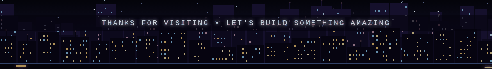

<!-- ============ TOP BANNER ============ -->

<!-- ============ ABOUT ME ============ -->

<table border="0" width="100%">
<tr>
<td width="60%" valign="top">
<h2>⚡ About Me</h2>

I’m a passionate <b>Computer Science student</b> with <b>2+ years</b> of hands-on experience in tech events, hackathons, and project building. I enjoy turning ideas into reality through code and have developed skills in <b>full-stack development</b>, <b>IoT</b>, and <b>AI-powered applications</b>.

As the leader of <b>Tech Busters Team</b>, I’ve guided peers in building innovative solutions, collaborating in hackathons, and exploring cutting-edge technologies. I believe in learning by doing, and every project I work on, from <b>IoT home automation</b> to <b>AI health apps</b>, pushes me to grow as both a developer and a team leader.

✨ <b>What Drives Me</b> 
• Solving real-world problems with technology 
• Exploring full-stack development and emerging tech 
• Sharing knowledge and building communities

🚀 <b>Currently Working On</b> 
• Dynamic full-stack web applications using <b>MERN Stack</b> 
• AI-powered features and ML / LLM-based apps

🤝 <b>Looking to Collaborate On</b> 
• Open-source projects 
• API development and scalable backend systems 
• AI / ML and IoT projects

🌱 <b>Currently Learning</b> 
• <b>Next.js</b> and <b>TypeScript</b> 
• <b>System Design</b> 
• <b>AI / Machine Learning</b> and Generative AI 
• <b>DevOps</b>: CI/CD, Docker & Kubernetes, Cloud (AWS, GCP)

💬 <b>Ask Me About</b> 
• React, Node.js, REST APIs & Databases 
• Hackathons and building as a team 
• Integrating AI into web apps

🌍 <b>Portfolio</b> 
• <a href="https://my-portfolio-vercel-nu.vercel.app/">my-portfolio-vercel-nu.vercel.app</a>

🎯 <b>Fun Fact</b> 
• I thrive in hackathons, they’re my caffeine boost! ☕🔥

<i>Always curious, always building, and always looking forward to new challenges, collaborations, and opportunities to learn.</i>

</td>

<td width="40%" align="center" valign="middle">

</td>
</tr>
</table>

<!-- ============ TECH STACK ============ -->

<h2>💻 Tech Stack</h2>

  

<!-- Languages -->

<!-- Frontend -->

<!-- Backend & DB -->

<!-- AI / ML -->

<!-- Tools -->

<!-- ============ SKILL LEVELS ============ -->

<h2>📈 Skill Levels</h2>

<table>
<tr>
<td>
 
 
 

</td>
<td>
 
 
 

</td>
</tr>
</table>

<!-- ============ FEATURED PROJECTS ============ -->

<h2>🚀 Featured Projects</h2>

<table width="100%">
<tr>
<td width="50%" valign="top">
<h3>🛒 MERN E-Commerce Store</h3>

A full-stack online store with product listings, cart, secure login and an admin dashboard.

<a href="https://github.com/omsatote?tab=repositories">🔗 Source Code</a> •
<a href="https://my-portfolio-vercel-nu.vercel.app/">🌍 Live Demo</a>
</td>

<td width="50%" valign="top">
<h3>🤖 AI Chatbot Assistant</h3>

A smart chatbot built into a MERN app that answers questions using an LLM API.

<a href="https://github.com/omsatote?tab=repositories">🔗 Source Code</a> •
<a href="https://my-portfolio-vercel-nu.vercel.app/">🌍 Live Demo</a>
</td>
</tr>

<tr>
<td width="50%" valign="top">
<h3>💬 DevConnect – Developer Community</h3>

A social platform where developers share posts, projects and ideas, built with Next.js.

<a href="https://github.com/omsatote?tab=repositories">🔗 Source Code</a> •
<a href="https://my-portfolio-vercel-nu.vercel.app/">🌍 Live Demo</a>
</td>

<td width="50%" valign="top">
<h3>✅ Smart Task Manager</h3>

A real-time task and productivity app with live sync, reminders and a clean dashboard.

<a href="https://github.com/omsatote?tab=repositories">🔗 Source Code</a> •
<a href="https://my-portfolio-vercel-nu.vercel.app/">🌍 Live Demo</a>
</td>
</tr>
</table>

🌍 See more on my <a href="https://my-portfolio-vercel-nu.vercel.app/"><b>portfolio</b></a> • 📂 <a href="https://github.com/omsatote?tab=repositories"><b>all repositories</b></a>

<!-- ============ HACKATHONS ============ -->

<h2>🏅 Hackathons & Achievements</h2>

<table width="100%">
<tr>
<th>Event</th>
<th>Result</th>
<th>What I Built</th>
</tr>
<tr>
<td>Hackathon Name 1</td>
<td>🥇 Winner / 🏆 Finalist / 🎖️ Participant</td>
<td>Short description of the project</td>
</tr>
<tr>
<td>Hackathon Name 2</td>
<td>🥈 Runner-up / 🏆 Finalist / 🎖️ Participant</td>
<td>Short description of the project</td>
</tr>
<tr>
<td>Hackathon Name 3</td>
<td>🎖️ Participant</td>
<td>Short description of the project</td>
</tr>
</table>

<!-- ============ CERTIFICATIONS ============ -->

<h2>📜 Certifications & Courses</h2>

<table width="100%">
<tr>
<th>Certification / Course</th>
<th>Issued By</th>
<th>Year</th>
</tr>
<tr>
<td>Machine Learning / AI Course Name</td>
<td>Coursera / Udemy / NPTEL</td>
<td>2026</td>
</tr>
<tr>
<td>Cloud Certification (AWS / GCP)</td>
<td>AWS / Google Cloud</td>
<td>2026</td>
</tr>
<tr>
<td>Next.js / Full-Stack Course Name</td>
<td>Platform Name</td>
<td>2026</td>
</tr>
</table>

<!-- ============ ROADMAP ============ -->

<h2>🗺️ Roadmap</h2>

<table width="100%">
<tr>
<td valign="top" width="33%">
<h3>🔨 Building</h3>
• Full-stack MERN project 
• AI chatbot with LLM API 
• Portfolio website
</td>
<td valign="top" width="33%">
<h3>📚 Learning</h3>
• Next.js 
• TypeScript 
• System Design 
• Machine Learning
</td>
<td valign="top" width="33%">
<h3>🎯 Next Goals</h3>
• Win more hackathons 
• Contribute to open source 
• Learn Docker & CI/CD 
• Get an AI Engineer role
</td>
</tr>
</table>

<!-- ============ GITHUB STATS ============ -->

<h2>📊 GitHub Stats</h2>

 

 

 

<!-- ============ ACTIVITY ============ -->

<h2>🏆 Activity & Contributions</h2>

  

<!-- ============ QUOTE ============ -->

<h2>✍️ Random Dev Quote</h2>

<!-- ============ CONNECT ============ -->

<h2>🌐 Connect With Me</h2>

  

  

<!-- ============ BOTTOM BANNER ============ -->

